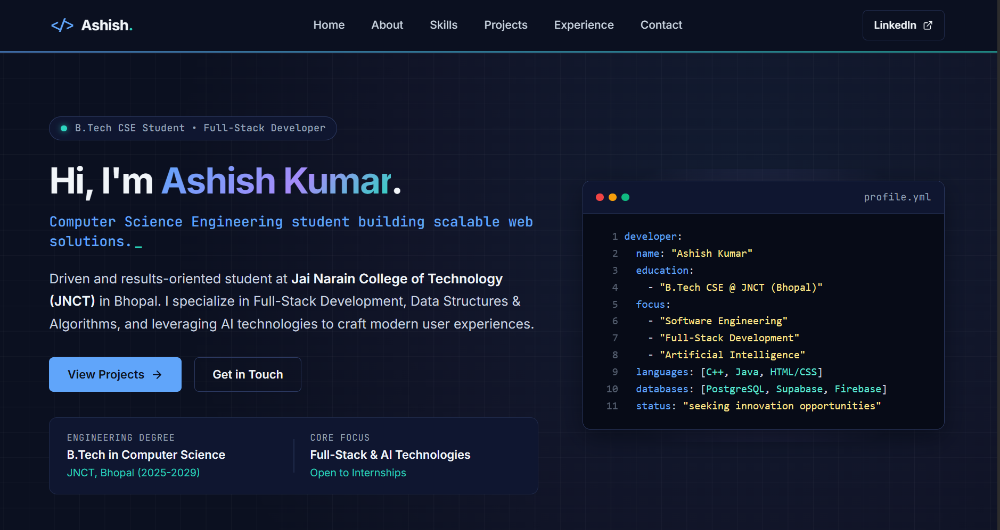
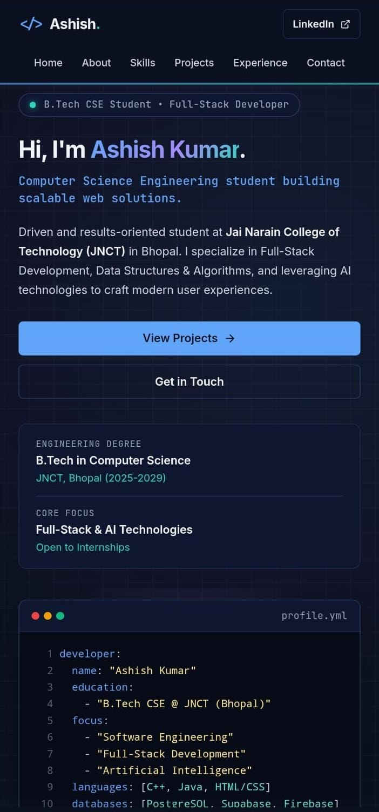

# Ashish Kumar

### Computer Science Engineering Student | Full-Stack Developer & AI Enthusiast

*Building scalable digital solutions and learning by shipping.*

<div align="center">

[**Explore My Portfolio →**](https://ashq-ghbi.github.io/qash-portfolio/)

</div>

---

## 📌 A Little About Me

Hi! I'm **Ashish Kumar**, a Computer Science and Engineering undergraduate at **Jai Narain College of Technology (JNCT)**, Bhopal. I specialize in Full-Stack Web Development, Data Structures & Algorithms, and modern cloud/AI technologies. 

I built this portfolio website as part of the **EWB HTML & CSS Internship Project** to showcase my technical skills, hackathon projects, and development journey—crafted strictly using semantic HTML5 and responsive CSS3 without any external frameworks or JavaScript.

---

## 🧭 Explore the Website

- **Home / Hero** — Quick introduction, developer status badge, and an interactive code card profile.
- **About Me** — Academic profile, engineering focus areas, and technical background.
- **Skills** — Categorized technical stack including programming languages, frontend tools, databases, and core CS fundamentals.
- **Projects** — Detailed highlights of featured work including *JanSetu* and the *Hospital Management System*.
- **Experience** — Timeline of internship work, E-Cell activities, and national hackathon participation records.
- **Contact** — Direct email coordinates, verified LinkedIn profile, and GitHub links.

---

## 🛠️ Built With

 
 


- **Semantic HTML5** for structured, accessible markup (`header`, `nav`, `main`, `section`, `article`, `footer`).
- **Modern CSS3** featuring CSS custom variables, Flexbox, CSS Grid layouts, and responsive media queries.
- **Zero JavaScript** to strictly comply with the internship constraints.

---

## 📸 Website Preview

### Desktop View



### Mobile View




---

## 🌐 Live Deployment

View the live portfolio website here:  
👉 [**Ashish Kumar — Developer Portfolio**](https://ashq-ghbi.github.io/qash-portfolio/)

---

## 💻 Run Locally

To view or test the project locally on your machine:

1. Clone the repository:
   ```bash
   git clone [https://github.com/AshQ-ghbi/Ashish_Kumar_HTML_CSS_Portfolio.git](https://github.com/AshQ-ghbi/Ashish_Kumar_HTML_CSS_Portfolio.git)
